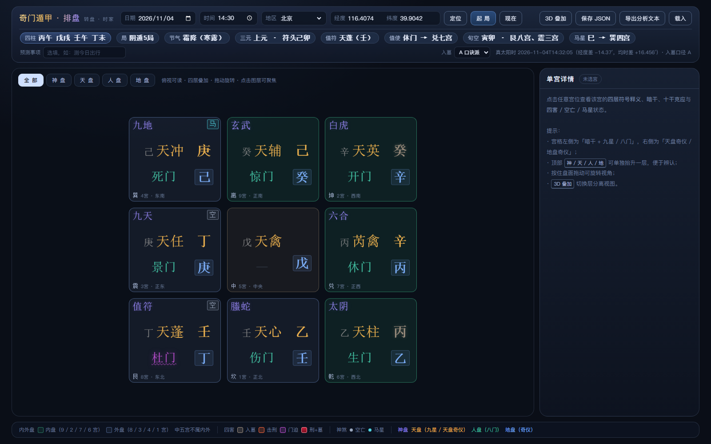
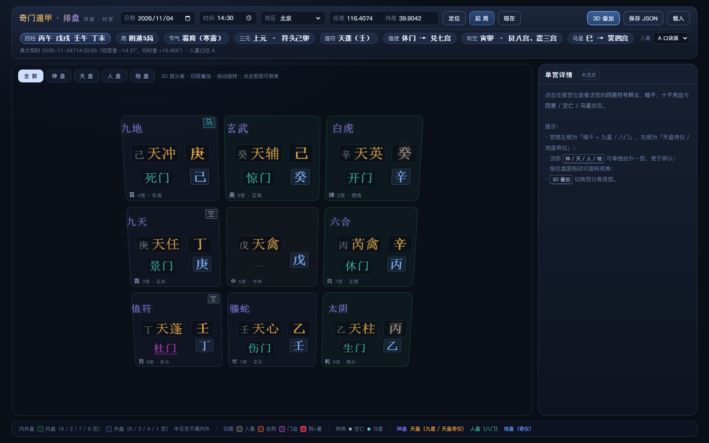
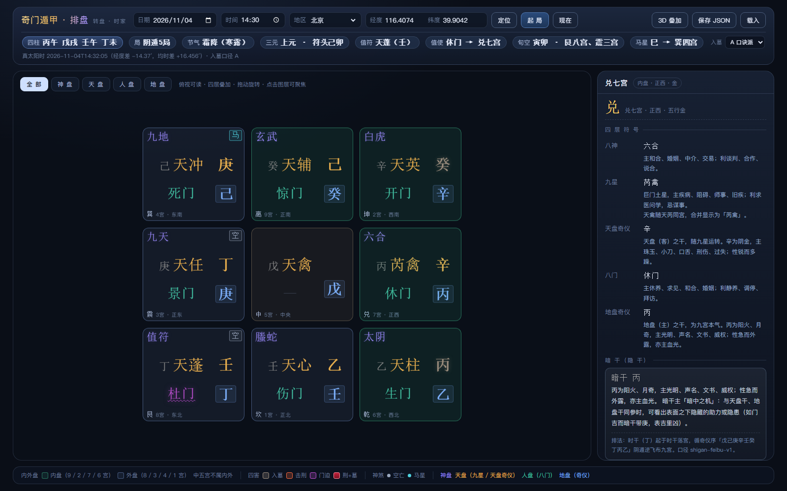
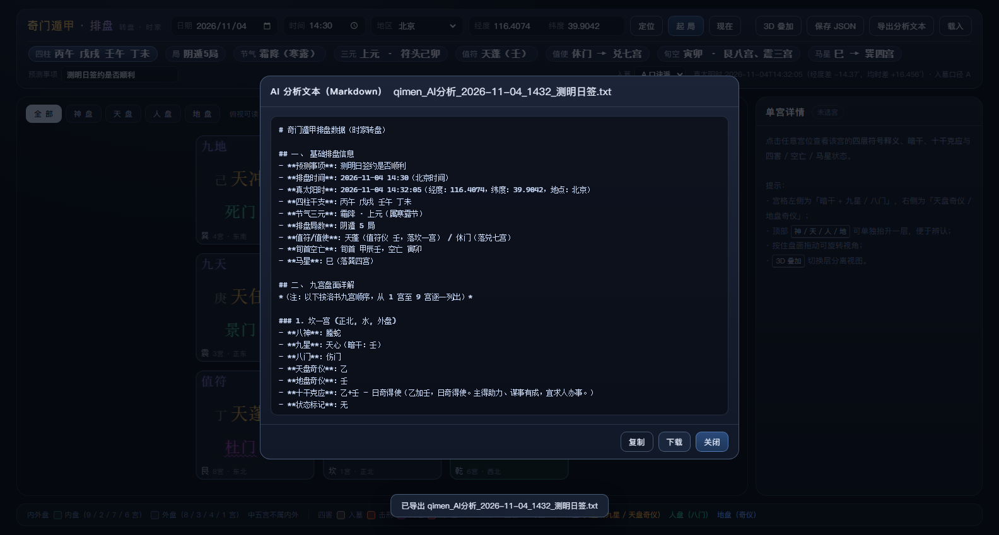

# 奇门遁甲排盘插件 · 转盘 · 时家奇门

一个**零第三方依赖**的「转盘·时家奇门」排盘插件：内置天文算法做真太阳时校正，自动起局，
以「九宫格四层叠加」呈现盘面，支持三维层聚焦、单宫详情、十干克应与 JSON 存盘/重载。



| 三维层分离（`3D 叠加`） | 人盘聚焦 + 单宫详情 |
| --- | --- |
|  |  |

---

## 一、快速开始

环境要求：**Node.js ≥ 18**（仅用于本地静态服务器与测试；排盘本身是纯前端）。

```bash
# 1. 启动（会自动构建浏览器包并起本地服务）
npm start
# 打开 http://127.0.0.1:5178/

# 或者分步：
npm run build     # 把 src/engine/*.js 打包成 web/qimen.engine.js
npm run serve     # 静态服务器（仅监听 127.0.0.1:5178）
npm test          # 运行 68 项测试
```

> 也可以直接双击 `web/index.html` 用浏览器打开（脚本为经典 `<script>`，无 ES Module 跨域限制）；
> 但「浏览器定位」与部分文件下载行为在 `file://` 下可能受限，推荐用 `npm start`。
>
> 需求中的 Three.js / WebGL 需要联网安装依赖，而本机 npm registry 不可达。
> 因此三维部分改用 **CSS 3D**（`perspective` + `translateZ` + `rotateX/rotateY`）实现，
> 不引入任何第三方库，效果与交互（层分离、层聚焦、拖动旋转）完整保留。详见「假设与取舍」第 12 条。

---

## 二、功能对照（需求 → 实现）

| 需求 | 实现位置 | 状态 |
| --- | --- | --- |
| 排盘类型固定「转盘·时家」 | `src/engine/qimen.js` `buildChart` | ✅ |
| 公历日期 + 时间（分钟）输入 | `web/index.html` 顶栏 | ✅ |
| 地点：定位 / 手动经纬度 / 地区列表 | `web/app.js` `locate`、`cities.js`（120+ 城市） | ✅ |
| 真太阳时 = 北京时 + 经度时差 + 均时差，实时回显 | `src/engine/solar_time.js`、`astro.js` | ✅ 两项均参与 |
| 定局：节气 + 三元（符头） | `src/engine/calendar.js` | ✅ 拆补口径 |
| 地盘奇仪阳顺阴逆 | `qimen.js` `buildDiPan` | ✅ |
| 值符=旬首仪 / 值使=旬首本位门 | `qimen.js` `layoutPalaces` | ✅ |
| 天盘：值符随时干，九星整体旋转 | `qimen.js` `layoutPalaces` | ✅ |
| 八门：值使随时支，八门整体旋转 | `qimen.js` `layoutPalaces` | ✅ |
| 八神：值符领头，阳顺阴逆 | `qimen.js` `layoutPalaces` | ✅ |
| 暗干（隐干）：时干飞布九宫 | `qimen.js` `buildAnGan` | ✅ 可复现盘例 |
| 芮禽合宫显示「芮禽」 | `qimen.js` `star_display` | ✅ |
| 内外盘随阴阳遁动态翻转 | `qimen.js` `nei_wai` | ✅ |
| 四害：击刑 / 入墓 / 门迫 / 刑+墓 | `constants.js` + `qimen.js` | ✅ |
| 空亡（时旬） / 马星（三合） | `qimen.js` | ✅ |
| 81 组十干克应（含 辛+癸=天牢华盖） | `src/engine/ke_ying.js`（100 组） | ✅ |
| 九宫格俯视可读 + 四层叠加 | `web/styles.css` `.board` / `.p-*` | ✅ |
| 宫格左右两列版式（暗干+星/门 ｜ 天盘干/地盘干） | `.p-main` 网格 | ✅ |
| 九宫格降噪（不显示克应文字） | 宫格仅保留基础符号 | ✅ |
| 内外盘颜色随阴阳遁翻转 | `.palace.nei` / `.wai` | ✅ |
| 空/马角标；四害互不覆盖可叠加 | `.corner-badges`、`.harm-*` | ✅ |
| 顶部标题与控件同一水平线 | `.topbar-main`（`align-items:center`） | ✅ |
| 经纬度输入框加宽、隐藏原生调节箭头 | `.field input[type="number"]` | ✅ |
| 页面固定图例 | `.legend`（内外盘数字随局更新） | ✅ |
| 三维层聚焦（300–500ms，再点复原） | `.layer-tab` + `.focus-*`，`transition .4s` | ✅ |
| 单宫选中：四层含义 + 克应 + 四害说明 | `web/app.js` `renderPanel` | ✅ |
| 存盘 JSON，文件名含时间与局数 | `web/app.js` `saveJSON` | ✅ |
| JSON 重载可复现同一盘面 | `web/app.js` `loadJSONFile` / `applyLoadedChart` | ✅ |
| **导出 AI 分析文本（Markdown/TXT）** | `src/engine/ai_text.js` + `web/app.js` `exportAiText` | ✅ |
| 预测事项输入（自由文本，存 `meta.prediction_topic`） | 局信息条 `#in-topic` | ✅ |

**文件名示例**：`qimen_2026-11-04_1432_阴遁5局.json`

---

## 三、界面与交互

### 1. 默认视图（九宫格俯视可读）
- 洛书方位：**上南下北、左东右西**；1 坎（下中）、2 坤（右上）、3 震（中左）、4 巽（左上）、
  5 中（中心）、6 乾（右下）、7 兑（中右）、8 艮（左下）、9 离（上中）。
- **每宫左右两列网格化**（按专业排盘版式）：
  - 左上角：**八神**；右上角：`空` / `马` 角标；
  - 左列：**暗干 + 九星**（上）、**八门**（下），两者水平居中对齐；
  - 右列：**天盘奇仪**（上）、**地盘奇仪**（下），严格同一条右对齐垂直线。
- **芮禽合宫**：天芮与天禽同宫时合并显示为 `芮禽`（格式 `[浅灰暗干] 芮禽`，如 `丙 芮禽`）。
- **暗干**：以浅灰（`#8b8b8b`）显示在九星左侧，与高亮的天盘奇仪区分。
- **信息降噪**：九宫格内**不显示十干克应文字**，也不放「刑+墓」角标；只保留神、星、门、干、空/马与四害颜色。
- 宫底色与边框区分**内盘 / 外盘**（中五宫单列样式）。

### 2. 四害标记（互不覆盖，可叠加）
| 标记 | 位置 | 视觉 |
| --- | --- | --- |
| 入墓 | 天盘奇仪 | 灰褐文字 + 下划波浪线 |
| 击刑 | 天盘奇仪 | 橙红文字 + 光晕 |
| 门迫 | 八门 | 紫红文字 + 下划波浪线 |
| 刑+墓 | 天盘奇仪 | 深红渐变底 + 描边 + 呼吸光晕（区别于单一标记） |

### 3. 三维层聚焦
- 点击顶部 `神盘 / 天盘 / 人盘 / 地盘`：该层沿 Z 轴抬升、放大，其余层降透明度并轻微模糊；
  再次点击同一标签或点 `全部` 复原；动画 `400ms`。
- 聚焦映射（与两列版式一致）：神盘 = 左上角八神；天盘 = 九星 + 天盘奇仪；人盘 = 八门；地盘 = 地盘奇仪。
- 点击 `3D 叠加`：四层沿 Z 轴整体拉开（神盘最上、地盘最下），**版式规则不变**；
  再点回到默认俯视可读态。
- 点击任意宫位：右侧「单宫详情」立即联动（八神 / 九星 / 天盘奇仪 / 八门 / 地盘奇仪、暗干、十干克应、四害）；
- 拖动旋转：按下后**移动超过 5px** 才判定为拖动（避免吞掉点击）；拖动结束后的 350ms 内忽略一次 click，防止「拖动即选中」；
- 默认视角为 **0° 俯视**，九宫为规整网格，保证宫位点击命中区域与视觉完全一致；

### 4. 单宫详情
点击任意宫展开：
- 四层符号（八神 / 九星 / 天盘奇仪 / 八门 / 地盘奇仪）各自的**含义**（含十天干象义）；
- 本宫**暗干**及其影响、所用排法口径；
- 本宫**十干克应**（如 `辛+癸：天牢华盖` 及断语）；
- 四害 / 空亡 / 马星状态与通俗说明；
- 3×3 快速选宫。

### 5. 顶部控制栏
- 标题区与日期、时间、地区、经纬度、按钮全部在同一行、**中心线水平对齐**（Flexbox `align-items:center`）。
- 经纬度输入框加宽至 78px，并隐藏原生数字调节箭头（`appearance:textfield` + 隐藏 `::-webkit-*-spin-button`）；
  日期 / 时间 / 数字 / 下拉均统一 `32px` 高度、同一套边框与内边距。
- 「入墓口径」移到第二行局信息条右侧，减少主行拥挤；窄屏（≤1500px）自动进入紧凑模式，仍保持单行。

### 7. 导出 AI 分析文本（Markdown / TXT）
- 位置：顶栏 **「保存 JSON」右侧** 的 `导出分析文本` 按钮；
- 点击后按固定四段模板生成 Markdown 并下载，同时在弹层预览（可复制 / 再次下载）；
- 文件名：`qimen_AI分析_[时间]_[预测事项前四个字].txt`（如 `qimen_AI分析_2026-11-04_1432_测明日签.txt`）；
- 内容来源：内存中的排盘 JSON，**不经过任何 HTML**，纯 Markdown；
- 必含：十干克应**名称 + 断语**、每宫四害/空亡/马星状态、暗干、内外盘划分、值符值使、旬空马星；
- 中五宫单列「寄宫说明」；若识别到伏吟/反吟会写入「特殊格局」；
- 预测事项在局信息条 `预测事项` 输入框填写（可空，空则导出为「未填写」），
  并随 JSON 存盘（`meta.prediction_topic`）。

模板结构：

```markdown
# 奇门遁甲排盘数据（时家转盘）

## 一、 基础排盘信息
- **预测事项** / **排盘时间** / **真太阳时**（含经纬度）
- **四柱干支** / **节气三元** / **排盘局数**
- **值符/值使** / **旬首空亡** / **马星**

## 二、 九宫盘面详解   ← 1–9 宫逐一列出
### 1. 坎一宫 (正北, 水, 外盘)
- **八神** / **九星**（附暗干）/ **八门**
- **天盘奇仪** / **地盘奇仪**
- **十干克应**：辛+癸 - 天牢华盖（断语…）
- **状态标记**：空亡、马星、击刑、入墓、门迫、刑+墓（无则「无」）

## 三、 图例与全局提示   ← 内外盘宫号、四害口径、特殊格局
## 四、 AI 分析提示语     ← 固定断局提示词
```



### 8. 深链（可分享）
支持 URL hash 直接复现视图，例如：

```
http://127.0.0.1:5178/#date=2002-04-07&time=08:00&lng=116.4074&lat=39.9042&rumu=A&layer=tian&palace=8
```

参数：`date` `time` `lng` `lat` `rumu`（A/B） `topic`（预测事项） `layer`（shen/tian/men/di） `view=3d` `palace`（1-9）。

---

## 四、目录结构

```
.
├── package.json
├── src/engine/                 # 起局内核（CommonJS，可 Node 直用 / 由脚本打包成浏览器包）
│   ├── astro.js                # 儒略日、ΔT、截断 VSOP87 太阳视黄经、均时差、24 节气求解
│   ├── calendar.js             # 干支历、五鼠遁、旬空、符头三元、三元定局表
│   ├── constants.js            # 九宫/九星/八门/八神、五行、击刑表、入墓表、地支宫位、马星
│   ├── ke_ying.js              # 十干克应表（9×9 必备 + 甲行甲列 = 100 组）
│   ├── solar_time.js           # 真太阳时 = 北京时 + 经度时差 + 均时差
│   ├── cities.js               # 离线地区经纬度库（120+）
│   ├── ai_text.js              # 导出 AI 分析文本（Markdown 模板拼接 + 文件名）
│   └── qimen.js                # 起局主流程 buildChart / buildChartFromGivens
├── scripts/
│   ├── build-browser-bundle.js # 内核 → web/qimen.engine.js（IIFE，零依赖）
│   ├── serve.js                # 本地静态服务器
│   ├── verify-click.js         # 可选：用本机 Chrome + CDP 真实鼠标验证「点击宫位→详情联动」
│   └── verify-export.js        # 可选：真实点击「导出分析文本」并校验 Markdown 结构/文件名
├── web/
│   ├── index.html              # 页面结构
│   ├── styles.css              # 视觉 + CSS 3D 层叠/聚焦
│   ├── app.js                  # 渲染、交互、存盘/重载、导出分析文本、深链
│   └── qimen.engine.js         # 自动生成，请勿手改
├── test/                       # 68 项测试（node:test，进程内运行）
│   ├── run-tests.js
│   ├── astro.test.js
│   ├── calendar.test.js
│   ├── ke_ying.test.js
│   ├── solar_time.test.js
│   ├── an_gan.test.js          # 暗干序列 / 芮禽合宫
│   ├── ai_text.test.js         # AI 分析文本模板 / 文件名 / 无 HTML
│   ├── qimen.test.js
│   ├── bundle.test.js
│   └── smoke-matrix.js         # 918 组组合的结构/自洽冒烟校验
├── screenshot-board.png
├── screenshot-3d.png
├── screenshot-focus.png
└── screenshot-export.png
```

---

## 五、JSON 数据模型

与需求第六节结构一致，`palaces` 按 1–9 宫顺序输出。额外补充字段（不破坏原结构）：

| 字段 | 说明 |
| --- | --- |
| `meta.jie` | 所属「节」（月柱依据；`jieqi` 为当前节气，可能为中气） |
| `meta.fu_tou` / `meta.xun_head` / `meta.xun_yi` | 符头、旬首、旬首所遁之仪 |
| `meta.zhi_fu.palace` / `meta.zhi_shi.palace` | 值符、值使落宫 |
| `meta.ma_xing_branch` / `meta.void_branches` | 马星地支 / 旬空二支 |
| `meta.si_zhu` / `meta.ju_label` | 四柱、中文局名（如「阴遁5局」） |
| `meta.true_solar_correction` | 经度差、均时差、合计（分钟） |
| `meta.an_gan_rule` / `meta.an_gan_start` | 暗干口径与起点（宫位、天干） |
| `palace.an_gan` / `palace.an_gan_rule` | 本宫**暗干**（隐干）及其口径 |
| `palace.star_display` / `palace.star_extra` | 展示用星名（天芮→`芮禽`）与同宫星（`天禽`） |
| `palace.element` / `palace.door_key` | 宫五行、门单字键（便于程序取用） |
| `palace.flags.*.palace` | 入墓/击刑的**目标宫位**（即使未命中也给参考宫） |

`nei_wai` 取值 `"nei" | "wai" | "zhong"`（中五宫不属内外盘，故单列 `zhong`）。

示例（节选，仅示意结构）：

```json
{
  "meta": {
    "paipan_type": "shijia_zhuanpan",
    "input_time": "2026-11-04T14:30:00+08:00",
    "location": { "name": "北京", "lng": 116.4074, "lat": 39.9042 },
    "true_solar_time": "2026-11-04T14:32:05+08:00",
    "yinyang_dun": "yin",
    "ju_number": 5,
    "ru_mu_kou_jing": "A",
    "prediction_topic": "",
    "jieqi": "霜降",
    "jie": "寒露",
    "yuan": "上元",
    "an_gan_rule": "shigan-feibu-v1",
    "an_gan_start": { "palace": 8, "stem": "丁" }
  },
  "palaces": [
    {
      "index": 1, "name": "坎一宫", "trigram": "坎", "direction": "正北",
      "nei_wai": "wai",
      "tian_pan_qi_yi": "乙", "di_pan_qi_yi": "壬",
      "star": "天心", "star_display": "天心", "star_extra": null,
      "door": "伤门", "god": "螣蛇",
      "an_gan": "壬", "an_gan_rule": "shigan-feibu-v1",
      "flags": {
        "kong_wang": false, "ma_xing": false,
        "ru_mu": { "active": false, "scope": "tian_pan_qi_yi", "palace": 2 },
        "ji_xing": { "active": false, "scope": "tian_pan_qi_yi", "palace": 9 },
        "men_po": { "active": false, "scope": "door" },
        "xing_jia_mu": false
      },
      "ke_ying": { "tian_gan": "乙", "di_gan": "壬", "name": "日奇得使", "meaning": "…" }
    }
  ],
  "ke_ying_table_version": "81-gan-ke-ying-v1",
  "saved_at": "2026-11-04T06:40:00.000Z"
}
```

---

## 六、算法要点

### 1. 真太阳时
```
真太阳时 = 北京时间 + (经度 − 120°) × 4 分钟 + 均时差
```
- **经度时差**：北京时间取 120°E 基准；东经为正、西经为负。
- **均时差**：Meeus《Astronomical Algorithms》ch.28（`E = L0 − 0.0057183° − α + Δψ·cosε`），
  精度约 0.01 分。实测 2026-11-03 ≈ +16.46 分、2026-02-11 ≈ −14.17 分，与天文年历一致。
- 校正后可能跨日、跨时辰边界（例如乌鲁木齐 00:10 → 前一日 22:00），起局以**校正后**的日/时为准。

### 2. 节气与定局
- 太阳**视黄经**用截断 VSOP87D（L0–L5 主要项）+ 光行差 + 章动；以 15° 等分定 24 节气。
- 节气时刻用「割线法 + 牛顿精修」求解，误差 < 1 分钟；对「日」级定局无影响。
- 当前节气取「视黄经所在 15° 区间」；局数查 `calendar.js` 的 24 节气三元定局表。
- **三元**：以符头（甲/己日）定，日干支序号 `% 15` → `0–4 上元 / 5–9 中元 / 10–14 下元`。

### 3. 三元定局表（摘要）
| 阳遁 | 上/中/下 | 阴遁 | 上/中/下 |
| --- | --- | --- | --- |
| 冬至 | 1 / 7 / 4 | 夏至 | 9 / 3 / 6 |
| 小寒 | 2 / 8 / 5 | 小暑 | 8 / 2 / 5 |
| 大寒 | 3 / 9 / 6 | 大暑 | 7 / 1 / 4 |
| 立春 | 8 / 5 / 2 | 立秋 | 2 / 5 / 8 |
| 雨水 | 9 / 6 / 3 | 处暑 | 1 / 4 / 7 |
| 惊蛰 | 1 / 7 / 4 | 白露 | 9 / 3 / 6 |
| 春分 | 3 / 9 / 6 | 秋分 | 7 / 1 / 4 |
| 清明 | 4 / 1 / 7 | 寒露 | 6 / 9 / 3 |
| 谷雨 | 5 / 2 / 8 | 霜降 | 5 / 8 / 2 |
| 立夏 | 4 / 1 / 7 | 立冬 | 6 / 9 / 3 |
| 小满 | 5 / 2 / 8 | 小雪 | 5 / 8 / 2 |
| 芒种 | 6 / 9 / 3 | 大雪 | 4 / 7 / 1 |

（完整表在 `src/engine/calendar.js` `JU_TABLE`，测试会校验三元位移只可能为 +3/+6。）

### 4. 布盘次序（两套环，勿混用）
- **洛书宫序**（地盘、值使数宫）：`1→2→3→4→5→6→7→8→9`（阳顺 / 阴逆）。
- **后天八卦环**（九星、八门、八神、天盘奇仪）：`1坎→8艮→3震→4巽→9离→2坤→7兑→6乾`。

| 盘 | 规则 |
| --- | --- |
| 地盘 | 戊起局数宫，按 戊己庚辛壬癸丁丙乙 阳顺阴逆布九宫 |
| 值符 | 旬首仪所落之地盘宫 → 该宫本位星；落中五宫寄坤二宫 |
| 天盘九星 | 值符星移至时干之宫；整盘沿后天环刚性旋转（阳顺阴逆） |
| 天盘奇仪 | 随星携带其**本位宫地盘奇仪**（如天蓬携坎宫之干） |
| 八门 | 值使门自旬首本位宫起、沿洛书序**数**至时支宫；八门盘沿后天环**逆转**布列（值使门落值使宫，八门各一次） |
| 八神 | 值符神落时干之宫，按 值符→螣蛇→太阴→六合→白虎→玄武→九地→九天 阳顺阴逆布列 |

### 5. 四害
- **击刑**：天盘六仪落相刑之宫（甲子戊→震3、甲戌己→坤2、甲申庚→艮8、甲午辛→离9、甲辰壬→巽4、甲寅癸→巽4）。
- **入墓**（默认 A 口诀派）：乙丙戊→乾6、甲癸→坤2、丁己庚→艮8、辛壬→巽4；切 B 改为五行墓库派。
- **门迫**：门五行克宫五行（如 惊/开金→震3/巽4 木、休水→离9 火、景火→乾6/兑7 金）。
- **刑+墓**：击刑与入墓**各自独立判定**后取与，仅此时 `xing_jia_mu = true`。
- **空亡**：时旬空亡二支映射到九宫（两支承同一宫时只标一宫）。
- **马星**：时支三合局 → 寅（艮8）/ 申（坤2）/ 亥（乾6）/ 巳（巽4）。

### 6. 暗干（隐干）
```
起点：时干落宫（时干甲则用旬首仪；落中五宫寄坤二宫）
次序：奇仪序 戊 → 己 → 庚 → 辛 → 壬 → 癸 → 丁 → 丙 → 乙（甲不入盘）
方向：阳遁顺飞（洛书 1→2→…→9）、阴遁逆飞（9→8→…→1）
范围：九宫各占一位（中五宫亦占一位，不跳过）
```
- **校验盘例**（阴遁二局，时干己落离九，逆飞）：
  `离9己 → 艮8庚 → 兑7辛 → 乾6壬 → 中5癸 → 巽4丁 → 震3丙 → 坤2乙 → 坎1戊` —— 与公开盘例一致。
- 口径标识：`an_gan_rule = "shigan-feibu-v1"`，写入 `meta` 与各宫；`meta.an_gan_start` 记录起点。
- 用法：暗干主「暗中之机」，与天盘干、地盘干同参，可看出表面之下隐藏的助力或隐患。
- **芮禽合宫**：天禽随天芮同行，展示层合并为「芮禽」（`star_display`），`star` 仍保留 `天芮` 供算法使用。

---

## 七、验收标准自检（需求第九节）

| # | 验收项 | 证据 |
| --- | --- | --- |
| 1 | 四层符号分布与权威转盘结果一致 | `test/qimen.test.js`「权威盘例 A」：阳遁六局（乙巳日庚辰时）八宫五层逐宫吻合；另附阴遁八局盘例（地盘/九星/八神一致，八门为流派差异，见假设 7） |
| 2 | 阴阳遁切换内外盘颜色翻转 | `test/qimen.test.js`「内外盘随阴阳遁翻转」+ 图例动态显示宫号 |
| 3 | 入墓口径 A 正确、切 B 变化 | `test/qimen.test.js`「入墓口径 A/B」；2002 盘 A=`2:癸、4:辛`，B=`1:壬、4:辛` |
| 4 | 击刑在天盘六仪、门迫在八门 | `flags.ji_xing.scope='tian_pan_qi_yi'`、`flags.men_po.scope='door'`（有测试） |
| 5 | `xing_jia_mu` 仅在两者同时成立 | 逐宫断言 `xing_jia_mu === (ji_xing && ru_mu)`；冒烟校验覆盖 918 组 |
| 6 | 含「辛+癸」宫显示「天牢华盖」及断语 | `test/ke_ying.test.js` + 单宫面板 |
| 7 | 存盘含 `ru_mu_kou_jing`，重载可复现 | `test/qimen.test.js`「JSON 结构与重载复现」；页面「载入」后自动重算校核 |
| 8 | 三维聚焦流畅、聚焦层可读、默认俯视 | CSS 3D；`screenshot-board.png`（默认）/ `screenshot-3d.png`（3D 叠加） |
| 9 | 真太阳时含经度时差与均时差 | `test/solar_time.test.js`：两项均非零且等于各自公式 |
| 10 | 暗干：每宫有隐干、九干各一次、可复现公开盘例 | `test/an_gan.test.js`（含阴遁二局盘例逐宫比对） |
| 11 | 芮禽合宫显示「芮禽」 | `test/an_gan.test.js`「芮禽合宫」+ 宫格截图 |
| 12 | 九宫格不显示克应、保留四害颜色 | 宫格 DOM 无克应节点；`screenshot-board.png` |
| 13 | 顶部标题与控件同一水平线、无数字调节箭头 | 见 `screenshot-board.png`（1600px）与 1280px 紧凑模式 |
| 14 | 导出 AI 分析文本：模板四段、九宫齐全、克应断语与四害完整、文件名规范 | `test/ai_text.test.js`（16 项）+ `npm run verify:export` |

运行全部测试：

```bash
npm test           # 68 项单元/集成测试
npm run test:smoke # 918 组组合的结构与内部自洽校验
npm run check      # 构建 + 上述两项
```

```text
tests 68 / pass 68 / fail 0
共检查 918 组，问题 0 条
```

---

## 八、假设与取舍（实现决策记录）

> 需求第三节已固化 9 条默认决策，以下为需求未覆盖、按「时家转盘主流实践」所做的选择，
> 以及为保持内部一致性而显式声明的口径。

1. **定局用「拆补法」**：需求第四节第 1 条明确「元用符头」，故按拆补口径——
   当前节气 + 当日符头三元。**不启用置闰法**。
   例：2002-04-07 08:00 北京，拆补为「清明下元·阳遁7局」；若按置闰（权威盘例原文）则为「春分下元·阳遁6局」。
   两者都对，属流派差异；本实现默认拆补，并在测试中用 `buildChartFromGivens` 注入置闰局数来校验四盘旋转规则。
2. **中气使用本节气三元**：24 节气各有独立三元局数（如霜降 5/8/2），不沿用前一「节」。
   但月柱仍以「节」为界（`meta.jie` 给出所属节）。
3. **年柱以立春为界、月柱用五虎遁**：时家奇门以节气定年月，故年柱在立春前归上一年；
   月柱按「节」取寅月为岁首。四柱随真太阳时判定。
4. **子时换日**：23:00–00:59 为子时，**日柱不换日**（以当日日干起子时），与主流时家奇门一致。
   若需「晚子时换日」口径，可在 `calendar.js` 的 `hourGanzhi` 调用处调整。
5. **中五宫寄坤二宫**：地盘/天盘判「时干落宫」「旬首仪落宫」时，中五宫按坤二宫处理。
   中五宫本身在盘面保留：天禽星不动、天盘奇仪取本宫地盘奇仪、无门无神。
6. **天禽星随天芮**：排盘书写时天禽与天芮同宫（`star` 字段以「天芮」呈现，UI 在中五宫单列天禽）。
   天盘奇仪按「星携本位宫地盘奇仪」推导（例：天芮本位坤2，携带坤2之地盘干）。
7. **九星/八门/八神的旋转方向**：见第六节表。**八门盘方向在阴遁存在流派分歧**：
   本实现取「值使门落值使宫 + 八门沿后天环逆转布列」，该口径与所引 2002 阳遁六局盘例
   逐宫吻合（九星/八门/八神/地盘/天盘奇仪全部一致）；对另一份阴遁八局盘例，九星、八神、地盘、天盘
   均一致，八门有整体宫位差（该例的值使门落宫推算亦与其正文自述略有出入）。属流派差异，
   已用结构不变式（八门各一次 + 值使门落值使宫）在测试中固化。
8. **值使数宫用洛书序**：自旬首本位宫起，阳遁 1→2→…→9、阴遁 9→8→…→1，每时辰一宫，遇中五宫跳过（寄坤2）。
   这与「八门沿后天环布列」是两套次序，代码中分别用 `SHI_RING` 与 `RING` 表示。
9. **甲的处理**：盘面天盘只有九干（甲隐于六仪）；克应表另补「甲行甲列」共 100 组，
   避免 UI 需要显示「甲」时无表可查。**9×9 = 81 组必备项完整**。
10. **入墓口径 A 的甲**：需求口诀「甲癸坤」，甲在盘面隐于戊，故 A 表按「甲→坤2」入表；
    实际判定只针对天盘九干，甲不会单独出现。
11. **内外盘不含中五宫**：`nei_wai` 为 `zhong`，避免强行归类造成误读。
12. **三维用 CSS 3D 而非 Three.js**：本机 npm registry 不可达，且需求允许「Three.js / WebGL」作为
    实现手段。CSS 3D 可完整表达「四层沿 Z 轴分离 + 层聚焦 + 拖动旋转」，且符号由 DOM 文本渲染，
    任意视角都保持可读（正好满足「不得让三维透视损害符号可读性」）。
    若需换成 Three.js，只需替换 `web/app.js` 的 `renderBoard` 与 `web/styles.css` 的 `.scene-*`，
    引擎与数据层无需改动。
13. **天盘奇仪与权威盘例的差异**：所引 2002 排局文章正文说明「将星本位宫的地盘奇仪写在星头上」，
    但其最终表格的天盘奇仪栏与该说明不完全一致（表格自身前后矛盾）。本实现以正文算法为准，
    九星/八门/八神/地盘与表格逐宫吻合。
14. **天文精度**：截断 VSOP87 视黄经误差约 0.005°（时间误差 < 10 分钟），对定局（日级）无影响；
    均时差误差 < 0.05 分。支持 1900–2100；ΔT 用 Espenak–Meeus 分段式，远离 2000 年时精度下降。
    节气求解只用近似初值 + 牛顿迭代，不依赖任何节气表。
15. **时间基准**：输入统一按「北京时间（UTC+8）」解释，真太阳时以 120°E 为基准做经度修正；
    不处理夏令时与历史时区变更。
16. **暗干口径**：采用「时干飞布」——时干起于时干落宫，循奇仪序阳顺阴逆布九宫（中五宫亦占一位），
    与公开盘例「阴遁二局 离9己→艮8庚→…」逐宫一致。另有「门暗干（八门本位地盘干）」等流派说法，
    本实现未采用；如需切换，可在 `buildAnGan` 外加一层策略。
17. **芮禽合并**：需求要求「芮、禽同落一宫时合并为芮禽」。本实现按「天禽随天芮同行」的通行写法，
    天芮落宫即显示「芮禽」，`star` 保留 `天芮`、`star_extra` 记 `天禽`，中五宫仍单列天禽。
18. **九宫格信息降噪**：克应文字、刑+墓角标已从宫格移除（仅在单宫详情展示），
    以避免与专业排盘版式的两列布局冲突；四害颜色标记全部保留。

---

## 九、参考

- 转盘奇门排局完整盘例（阳遁六局）：<https://www.daoisms.com.cn/2010/01/12/23205/>
- 转盘奇门起局思路与排法（同源盘例）：<https://m.sohu.com/a/398916929_120339516/>
- 阴遁完整盘例（阴遁八局）：<https://mymingshu.com/qimen/cases/plate-02>
- 三元定局与飞盘/转盘说明：<https://panming-dev.github.io/qimen-mingfa-blog/blog/di-er-zhang-fei-pan-qi-ju/>
- 天文算法：Jean Meeus, *Astronomical Algorithms*, 2nd ed.（ch.7 儒略日、ch.22 章动、ch.25 太阳位置、ch.28 均时差、Appendix III VSOP87）

> 十干克应表为通行口诀整理（81 组必备 + 甲行甲列），断语供参考，不作唯一结论；
> 实际断卦须结合九星、八门、八神与宫位旺衰综合判断。

---

## 十、修复记录

### 2026-11-04 · 点击宫位后「单宫详情」不联动

**现象**：点击任意宫位，右侧详情面板无任何变化。

**根因（两处叠加）**：
1. `#scene-wrap` 的 `pointerdown` 里调用了 `setPointerCapture()`。指针一旦被捕获，后续指针事件
   与派生的 `click` 都会被重定向到捕获元素（`#scene-wrap`），宫位上的 `click` 监听器永远收不到事件。
2. 默认视角带 `rotateX(-8°)` 透视倾斜。`getBoundingClientRect()` 返回的是倾斜后**投影的包围盒**，
   其中心点并不落在实际绘制的四边形内（中间/下方两排尤其明显），因此在宫位视觉中心附近点击
   会命中宫格间隙，从而丢失点击。

**修复**：
- 移除 `setPointerCapture`，改为在 `window` 上监听 `pointermove / pointerup`；
- 按下后**移动超过 5px 才判定为拖动**，拖动结束后的 350ms 内忽略一次 `click`（不影响正常点击）；
- 增加 `pointerup` 兜底选中，并对 `pointerup` 与 `click` 的重复触发做 450ms 去重；
- 默认视角改为 **0° 俯视**（真正的「九宫格俯视可读态」，命中区域与视觉一致）；
  拖动与 `3D 叠加` 仍可倾斜视角。

**验证**（真实鼠标事件，非脚本合成）：
```bash
node scripts/verify-click.js   # 需要本机 Chrome；逐个点击九宫并读取面板标题
# 宫1→坎一宫 … 宫9→离九宫 全部联动；拖动后视角改变且不误选
```

---

## 十一、许可

MIT
